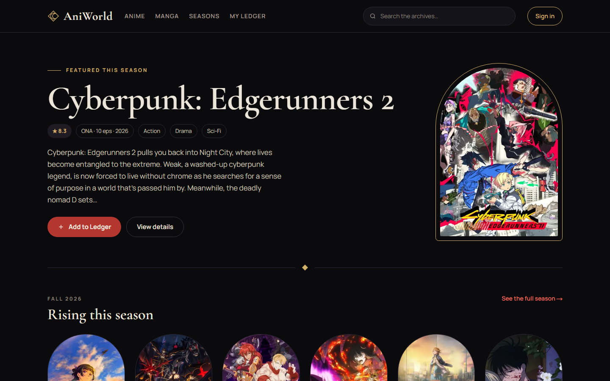
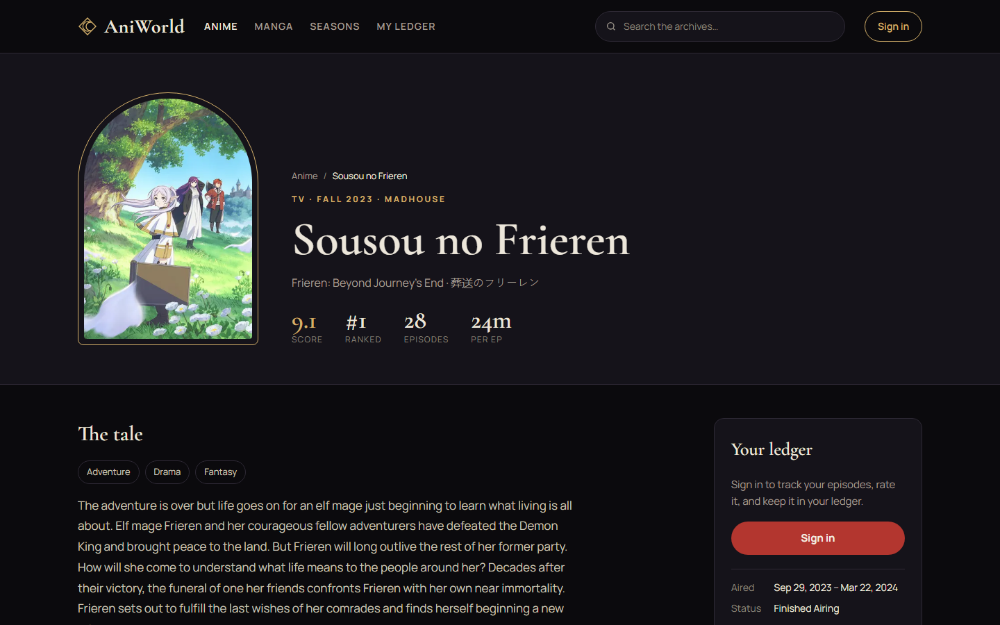
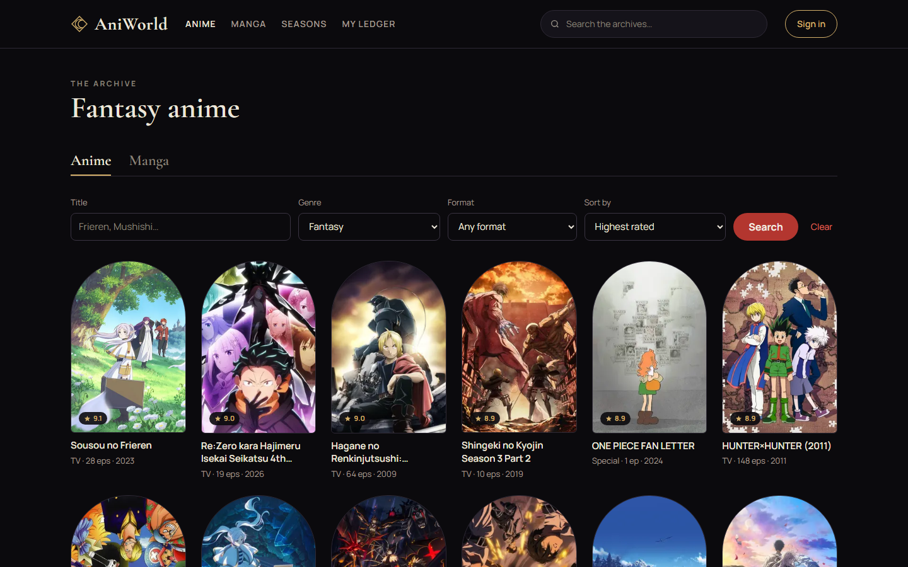
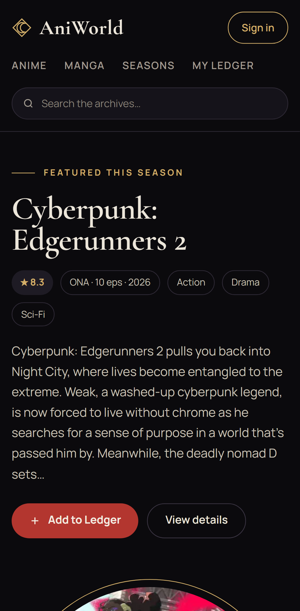

# AniWorld

Track the anime you watch and the manga you read: browse seasons and rankings, read manga chapters,
keep a personal list and leave reviews.

The backend lives in [AniWorldAPI](https://github.com/cesardecasas/AniWorldAPI).



| Anime detail | Search | Mobile |
| --- | --- | --- |
|  |  |  |

## Features

* **Discover**: the featured title and rising anime of the current season, all-time rankings, season archives,
  and search with genre, format and sort filters (plain links and forms, so it all works without JavaScript)
* **Read**: manga chapters from MangaDex in any available language, with a data-saver mode and your place saved
* **Keep a ledger**: track status, progress and a 1–10 rating for every title; your public ledger page shows it all
* **The tavern**: reviews on every title, with ||spoiler|| tags
* **Dark Fantasy design**: arched key art, Cormorant Garamond display type, gold and crimson on obsidian

## Technologies

* Next.js 16 and React 19, TypeScript
* App Router: server components fetch AniList and MangaDex with incremental static regeneration; client components
  (TanStack Query) handle the ledger, reviews and session
* Tailwind CSS 4, with the design tokens in `client/app/globals.css`
* Jest for unit tests, Playwright for end-to-end tests
* Hosted on Netlify, with an edge function that blocks scrapers and bad bots

## Data sources

* [AniList](https://docs.anilist.co/) — anime details, seasons and rankings
* [Jikan](https://docs.api.jikan.moe/) — optional extras (theme songs, episode titles) when its public instance is up
* [MangaDex](https://api.mangadex.org/docs/) — manga and chapters
* [Animechan](https://animechan.io/) — quotes
* [AniWorldAPI](https://github.com/cesardecasas/AniWorldAPI) — accounts, lists, reviews and reading progress

## How sign-in works

The browser never talks to AniWorldAPI directly. This app's `/api/v1/*` routes forward requests to it and keep the
login token in an httpOnly, SameSite=Lax cookie, so page scripts can't read it. Writes are only accepted from this
site (CSRF check), and the visitor's IP is passed on so the API's rate limits apply per person.

## Running locally

```bash
cd client
npm install
cp .env.example .env.local   # point API_URL at a running AniWorldAPI
npm run dev                  # http://localhost:3000
```

| Command | What it does |
| --- | --- |
| `npm test` | Jest unit tests |
| `npm run test:e2e` | Playwright tests on desktop and mobile (starts the dev server; sign-in tests need the API) |
| `npm run lint` / `npm run typecheck` | ESLint and TypeScript |

The Dark Fantasy design tokens can be previewed at `/design` in development. To refresh the README screenshots,
run `npx tsx e2e/screenshots.ts` with the app running (`BASE_URL` picks the server).

## Deploying (Netlify)

Set these environment variables on the site:

| Variable | Value |
| --- | --- |
| `API_URL` | The AniWorldAPI URL, e.g. `https://aniworld-api.onrender.com` |
| `API_PROXY_SECRET` | Same value as the API's `API_PROXY_SECRET` |
| `NEXT_PUBLIC_TURNSTILE_SITE_KEY` | Optional: enables the Cloudflare Turnstile challenge on sign-up, sign-in and reviews |

Netlify sets `URL` automatically; it is used for the sitemap, `robots.txt` and social previews.
